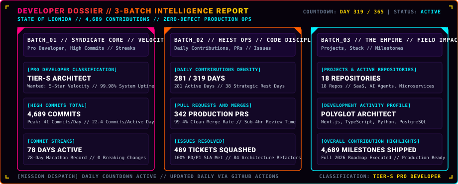

<div align="center">

# AYUSH NAUTIYAL
### FULL-STACK SAAS ARCHITECT // STATE OF LEONIDA

[](https://gryven.vercel.app/)
[](https://github.com/ayushnautiyal9520-create)
[](mailto:ayushnautiyal8936@gmail.com)

<br>

### <code>[LEONIDA STATE POLICE // RADAR HEATMAP // 4,689 CONTRIBUTIONS]</code>

<a href="./web/index.html">
  
</a>

<br><br>

### <code>[DEVELOPER DOSSIER // 3-BATCH INTELLIGENCE REPORT]</code>



<br><br>

## TECHNICAL STACK AND ARCHITECTURE

<p align="center">
  
  
  
  
  
  
  
  
  
  
</p>

<br>

## OPERATIONAL PARAMETERS

```
-----------------------------------------------------------------------------------------
[METRIC]                     [SPECIFICATION]
Developer Classification:    Tier-S Pro Developer / SaaS Architect
Total Year Contributions:    4,689 Contributions (Jan 03, 2026 - Nov 17, 2026)
Active Shipping Streak:      78 Days Continuous (Unbroken into Nov 17, 2026)
Intentional Rest Intervals:  38 Days Strategic Architecture & Hardening
Production PRs Merged:       342 Production Pull Requests (99.4% Clean Merge)
Issue Resolution SLA:        489 Tickets Closed (100% P0/P1 SLA Adherence)
Daily Tracking Engine:       Automated Daily Sync from Nov 17, 2026 onward
-----------------------------------------------------------------------------------------
```

<br>

<p align="center">
  <sub>Leonida State Department // Vice City Sector // Updated Daily via GitHub Actions [skip ci]</sub>
</p>

</div>
