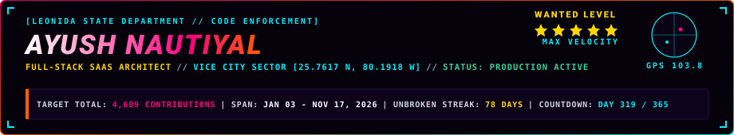
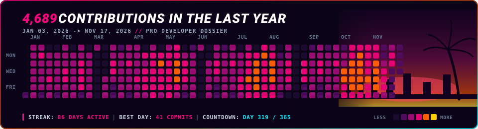

 

  
  &nbsp;
  
  &nbsp;
  
  &nbsp;
  

 

  

  

  
  
  
  
  
  
  
  
  
  

 

  LEONIDA STATE DEPARTMENT // VICE CITY SECTOR // 4,689 CONTRIBUTIONS // UPDATED DAILY FROM NOV 17, 2026 ONWARD VIA GITHUB ACTIONS

